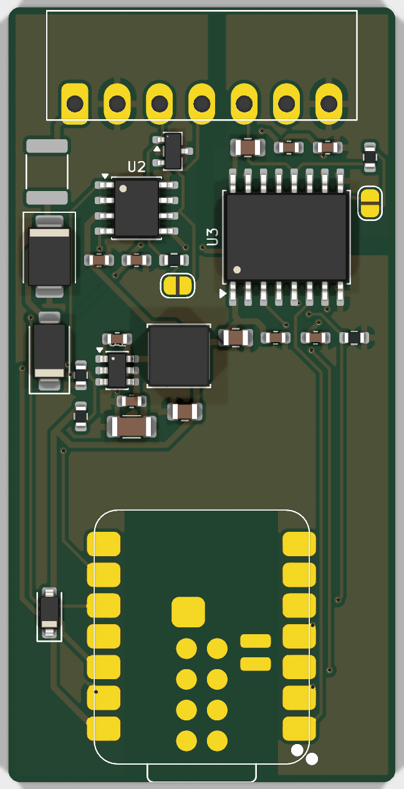
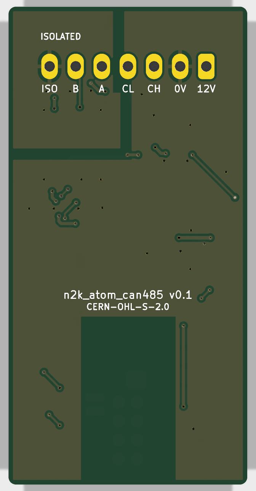

# n2k_atom_can485_hw

A carrier board for the Seeed Studio XIAO ESP32-S3 that puts NMEA 2000 (CAN) and RS485/RS422 on one board, with a 3D-printed enclosure. It is powered from the NMEA 2000 drop, so one cable carries power and data. Made for gateways between NMEA 0183 devices on RS422 (for example an AIS transponder) and an NMEA 2000 network. (The name is from a first plan built on the M5Stack ATOM.)

Status: v0.1 ordered (JLCPCB, partly assembled), not yet built or tested. [Schematic PDF](docs/n2k_atom_can485-schematic.pdf), KiCad 10 project in `kicad/`, Gerbers, BOM and placement files for JLCPCB in `fab/`.

| Top | Bottom |
|---|---|
|  |  | Design and open questions: [docs/SPEC.md](docs/SPEC.md).

## Planned features

- NMEA 2000 / CAN transceiver (±58 V bus pins), 3.3 V logic, on the ESP32-S3's TWAI controller.
- Isolated RS485/RS422 transceiver, so the RS422 device's ground stays separate from the NMEA 2000 network ground.
- 12 V NMEA 2000 network power → 5 V for the XIAO, with reverse-polarity, overcurrent and surge protection.
- Optional 120 Ω termination on each bus, off by default: close solder jumper JP1 (CAN, next to the CAN transceiver) or JP2 (RS485, beside the RS485 chip).
- One pluggable terminal block: NET-S, NET-C, CAN-H, CAN-L, RS485 A, RS485 B, RS485 isolated GND.
- 32 × 64 mm, 2 layers. Built at JLCPCB with SMT assembly.

## Pins (XIAO ESP32-S3)

| Function | Pin | GPIO |
|---|---|---|
| CAN TX / RX | D8 / D9 | 7 / 8 |
| RS485 TX / RX / DE | D0 / D1 / D3 | 1 / 2 / 4 |

## License

CERN-OHL-S-2.0. See [LICENSE](LICENSE).
