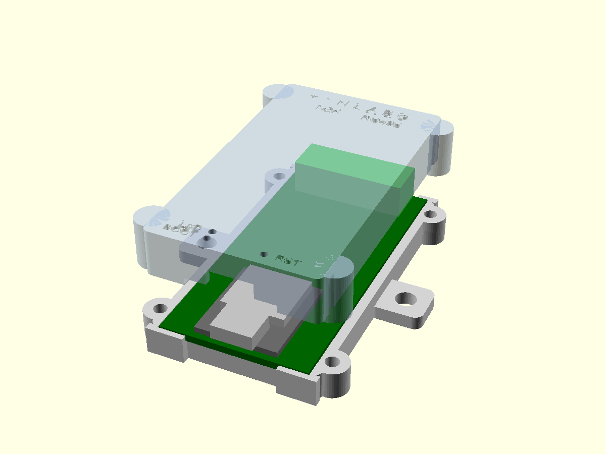

# Enclosure

A 3D-printed base and lid in OpenSCAD: [`n2k_atom_can485_case.scad`](n2k_atom_can485_case.scad). The board has no mounting holes; the case holds it by its edges.

Ready-to-print STLs: [`n2k_atom_can485_case-base.stl`](n2k_atom_can485_case-base.stl) and [`n2k_atom_can485_case-lid.stl`](n2k_atom_can485_case-lid.stl), rendered from the `.scad` with OpenSCAD 2021.01 at its default settings. Re-export them after changing the `.scad`.

- **Base:** the board drops in and rests on 1 mm ledges along its long edges and on the end walls. Hooks at the four corners, just past the board ends, stop it sliding when the plug goes in or comes out. The hooks stay clear of the terminal plug and of a USB-C plug's overmould.
- **Lid:** ribs press on the board's long edges and the end walls press on its ends. The base walls stop 0.2 mm below the board's top face, so the lid clamps the board, not the base. A relief in the right-hand rib clears JP2.
- **Openings:**
  - The terminal header fills the opening at one end; the case face sits 0.3 mm behind the header face, so the plug seats against the header.
  - The XIAO's USB-C sits about 0.4 mm proud of the case face at the other end, so any cable seats fully.
  - Holes over the user LED and the BOOT and RESET buttons, with short tubes down to just above the USB receptacle. Press the buttons with a pin.
- **Labels** are engraved on the lid:
  - Terminal pins: `+` NET-S, `-` NET-C, `H` CAN-H, `L` CAN-L, `A`, `B`, `G` RS485 isolated ground.
  - Holes: BOOT, LED and RST.
- **Mounting:** two side tabs with 4.5 mm holes (set `mount_tabs = false` to leave them off).
- **Size:** 36.5 mm wide (44.3 over the screw bosses, 56.5 over the tabs), 66.7 mm long over the corner hooks, 16.3 mm high.

## Dimensions used

| What | Value | Source |
|---|---|---|
| Board | 32 × 64 × 1.6 mm | KiCad layout |
| Part positions (J1, XIAO, USB-C, LED, buttons, JP2) | see the `.scad` file | KiCad layout. XIAO features are from Seeed's KiCad PCB for the XIAO ESP32-S3: user LED (GPIO21), BOOT button K2 (GPIO0), RESET button K1 (EN) |
| Tallest SMD part | L1, 4.0 mm | KiCad 3D model |
| XIAO PCB / shield top / USB-C | 1.25 / 3.24 / 1.25–4.46 mm above the carrier; USB-C 8.94 mm wide and 1.5 mm past the XIAO edge | Seeed's XIAO ESP32-S3 3D model (`XIAO-ESP32S3 v2.step`) |
| Terminal header MX15EDGRC-3.5-07P | 25.4 wide × 9.2 deep; 7.10 or 7.50 high (the drawing gives both in different views; the case clears 7.5); pin tails 3.5 mm | MX15EDGR-3.5-XXP family drawing |
| Plug MX15EDGK-3.5-07P | 25.6 wide, 11.1 high, 15.9 long (6.6 of it inside the header) | MX15EDGK-3.5-XXP family drawing |

## Hardware

- 4 × M2.5 × 10 screws, head up to 5.5 mm across, from below into the lid. The lid has 2.2 mm pilot holes for thread-forming into the plastic; for heat-set inserts, set `screw_pilot` to the insert's hole size.
- 2 × M4 or #8 screws through the tabs to mount it.

## Print

- Export each part from OpenSCAD with `part = "base"` and `part = "lid"`; both come out in print orientation, so no supports are needed. Command line:

  `openscad -D 'part="base"' -o base.stl n2k_atom_can485_case.scad`

- PETG or ASA. PLA softens in a hot cabin or engine space.

## Assembly

1. Set the termination jumpers (JP1 CAN, JP2 RS485) first. They're closed inside the case.
2. If WiFi is used, fit the antenna that ships with the XIAO to its U.FL connector, and stick the antenna under the lid.
3. Drop the board into the base, terminal end between the taller hooks.
4. Fit the lid and screw it on from below.

## Not yet checked

The case hasn't been printed or test-fitted.

- **Board fit:** clearances are 0.25 mm per side and 0.15 mm at the ends. Adjust `c` and `cy` after a test print.
- **J1 height:** check it on a part. The lid clears 8.5 mm over the board.
- **Plug drop below the board:** how far the plug reaches below the board top is not on the drawing. The base stays behind the header face across the plug's width, so the plug can't hit it.
- **XIAO position:** it's hand-soldered; the USB-C and button positions assume it sits centred on its footprint.
